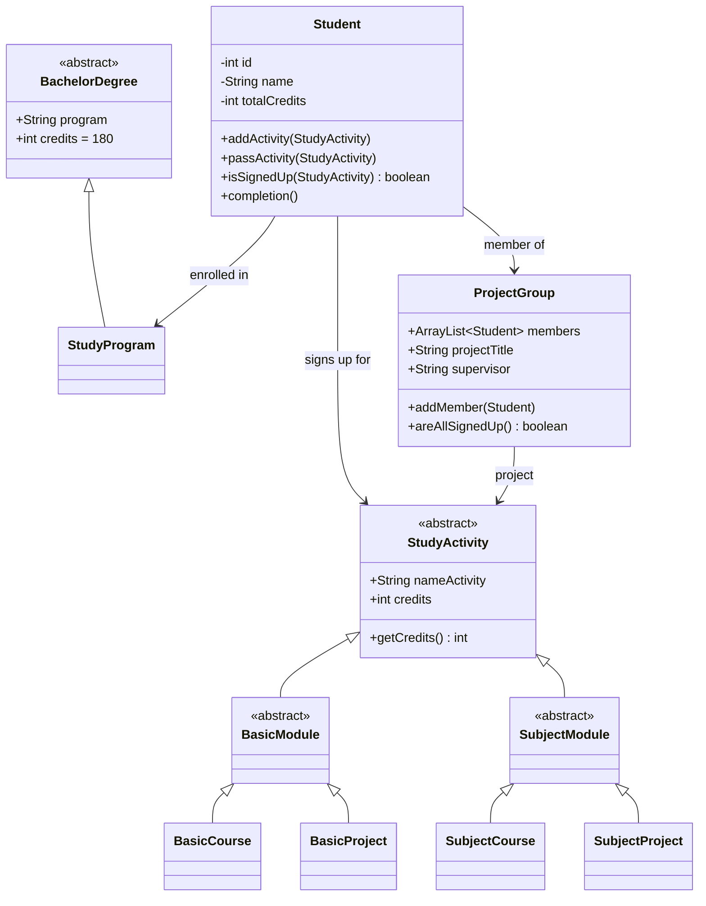

# Portfolio 1 – Study Program Model (Java OOP)

Portfolio 1 for the **Software Development** course at Roskilde University (RUC).

This program is an object-oriented model of a bachelor study program. Students sign up for study activities (courses and projects), form project groups, pass activities to earn ECTS credits, and check how far they are from finishing their degree.

## Features

- **Study activity hierarchy.** Activities are either *basic* or *subject* modules, and each can be a course or a project.
- **Credits.** Each activity type has a fixed ECTS value, and a bachelor degree needs 180 ECTS.
- **Sign-up.** `addActivity` uses pattern matching in a `switch` to sort each activity into the right list.
- **Passing activities.** A student can only pass an activity they have signed up for. Passing adds its credits to their total.
- **Project groups.** A group is linked to a project, a title and a supervisor. Only students signed up for that project can join it.
- **Completion check.** Shows whether the degree is complete or how many credits are still missing.
- **Input validation.** Invalid input throws `IllegalArgumentException` (null or blank values, or a student who isn't signed up).

## Class structure



| Class | Type | ECTS |
|---|---|---|
| `BasicCourse` | Basic module course (e.g. Calculus) | 5 |
| `BasicProject` | Basic module project | 15 |
| `SubjectCourse` | Subject module course (e.g. Software Development) | 5 |
| `SubjectProject` | Subject module project | 15 |

## Requirements

- **JDK 25 or newer.** The program prints with `java.lang.IO.println`, which was added in Java 25, and it uses pattern matching for `switch` (Java 21+).

## How to run

```bash
javac Portfolio1.java
java Portfolio1
```

On JDK 25 you can also skip compiling and run the source file directly:

```bash
java Portfolio1.java
```

## Example output

`main` creates a study program, two students and some activities. Rodrigo signs up for a course, a subject course and a basic project. He creates a project group and passes the project. Then Millaray signs up for the project and joins the group.

```
[project1]
[]
[title]
Not Completed yet, 165 credits missing
```

Rodrigo has passed one 15-ECTS project, so he still needs 165 of the 180 ECTS.

## Concepts demonstrated

- Abstract classes and inheritance
- Polymorphism (each `StudyActivity` subtype is handled through the same interface)
- Encapsulation (private fields in `Student`)
- Pattern matching for `switch` with type patterns
- Static nested classes
- Exceptions for input validation
- Collections (`ArrayList`)

## Author

Camilo Vergara Muñoz – B.Sc. Computer Science and Mathematics, Roskilde University
